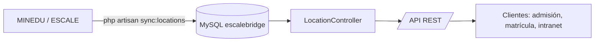

<div align="center">

# 🏫 Bridges Note

### API REST del catálogo educativo del Perú

Sincroniza, estructura y sirve **regiones, provincias, distritos y colegios** desde la API pública de **MINEDU / ESCALE**.

[](https://www.php.net/)
[](https://laravel.com/)
[](https://www.mysql.com/)
[](https://github.com/Ivan-10k/brigesnote/actions/workflows/tests.yml)
[](LICENSE)

[Inicio rápido](#-inicio-rápido) · [API](#-api-rest) · [Sincronización](#-sincronización-de-datos) · [Producción](#-producción) · [Solución de problemas](#-solución-de-problemas)

</div>

---

> [!IMPORTANT]
> **Estado del proyecto:** migración a **Laravel 13 / PHP 8.3** completada. **16 tests** pasando y **CI en verde**.

| Componente | Estado |
|---|---|
| Migración a PHP 8.3 / Laravel 13 | ✅ Completada |
| Base de datos MySQL | ✅ Validada |
| Sincronización MINEDU | ✅ 25 regiones · 196 provincias · 1,892 distritos · 114,750 colegios |
| Tests automatizados | ✅ 16 tests · 48 assertions |
| GitHub Actions | ✅ Passing |
| Documentación API | ✅ Disponible en este README |

## 📖 Tabla de contenidos

- [Propósito](#-propósito)
- [Características](#-características)
- [Stack tecnológico](#-stack-tecnológico)
- [Requisitos](#-requisitos)
- [Arquitectura y flujo](#-arquitectura-y-flujo)
- [Inicio rápido](#-inicio-rápido)
- [Configuración del entorno](#-configuración-del-entorno)
- [Sincronización de datos](#-sincronización-de-datos)
- [API REST](#-api-rest)
- [Modelo de datos](#-modelo-de-datos)
- [Estructura del proyecto](#-estructura-del-proyecto)
- [Tests y CI](#-tests-y-ci)
- [Producción](#-producción)
- [Seguridad](#-seguridad)
- [Solución de problemas](#-solución-de-problemas)
- [Contribuir](#-contribuir)
- [Licencia](#-licencia)

---

## 🎯 Propósito

**Bridges Note** nace para que aplicaciones de admisión, matrícula, intranets y sistemas internos puedan consultar el catálogo educativo del Perú **sin depender de la latencia o disponibilidad de los servidores de MINEDU**.

La aplicación descarga los datos oficiales, los normaliza en MySQL y expone una **API REST simple, rápida y predecible** para autocompletar ubigeos y consultar instituciones educativas.

---

## ✨ Características

| | |
|---|---|
| ✅ **Sincronización completa** | Regiones, provincias, distritos y colegios |
| 🔁 **Idempotente** | Usa `upsert` por lotes; puedes repetir el sync sin duplicar datos |
| ⏯️ **Reanudable** | `--region=17` continúa desde esa región hasta la última |
| 🎯 **Sync puntual** | `--district=150101` sincroniza solo los colegios de un ubigeo |
| 📄 **Paginación** | Instituciones de 50 en 50 usando el parámetro `start` |
| 🧹 **Deduplicación** | Evita registros repetidos por `codMod` |
| 🛡️ **Reintentos** | 3 intentos ante timeouts o errores 5xx |
| 🧪 **Tests** | 16 tests y 48 assertions |
| ⚙️ **CI** | GitHub Actions con PHP 8.3 y MySQL 8.4 |
| 🚀 **Producción** | DocumentRoot `public/`, cache, migraciones y health check |

---

## 🧱 Stack tecnológico

| Capa | Tecnología |
|---|---|
| Backend | Laravel 13.x |
| Lenguaje | PHP 8.3+ (probado con 8.3.36) |
| Base de datos | MySQL 8.0+ / MariaDB 10.6+ |
| Tests | PHPUnit + SQLite en memoria |
| CI | GitHub Actions |
| Servidor | Apache, Nginx, Laragon o `php artisan serve` |

---

## ✅ Requisitos

- **PHP 8.3+** con las extensiones:
  - `pdo_mysql`
  - `mbstring`
  - `openssl`
  - `curl`
  - `fileinfo`
  - `zip`
  - `pdo_sqlite` y `sqlite3` solo para tests
  - `intl` es opcional, necesaria para `php artisan db:show`
- **Composer 2.8+**
- **MySQL 8.0+** o **MariaDB 10.6+**
- **DocumentRoot:** debe apuntar a `public/`, nunca a la raíz del proyecto

> [!WARNING]
> No expongas `.env`, `vendor/` ni `storage/` desde el servidor web.

---

## 🧭 Arquitectura y flujo



1. El comando `sync:locations` descarga la información oficial de MINEDU.
2. Los datos se normalizan y guardan con `upsert` en MySQL.
3. `LocationController` consulta la base local y responde en JSON.
4. Las aplicaciones cliente consumen la API sin llamar directamente a MINEDU.

---

## 🚀 Inicio rápido

### 1. Clonar el repositorio

```bash
git clone https://github.com/Ivan-10k/brigesnote.git
cd brigesnote
```

### 2. Instalar dependencias

```bash
composer install
```

### 3. Configurar el entorno

**Windows (PowerShell):**

```powershell
Copy-Item .env.example .env
php artisan key:generate
```

**Linux / macOS:**

```bash
cp .env.example .env
php artisan key:generate
```

### 4. Crear la base de datos

```sql
CREATE DATABASE escalebridge
  CHARACTER SET utf8mb4
  COLLATE utf8mb4_unicode_ci;
```

### 5. Ejecutar migraciones

```bash
php artisan migrate
```

### 6. Sincronizar el catálogo

```bash
php artisan sync:locations
```

> [!TIP]
> La sincronización completa puede tardar entre **20 y 60 minutos** según la red y la disponibilidad de MINEDU. Si se interrumpe, puedes reanudar desde una región.

### 7. Levantar el servidor

```bash
php artisan serve
```

Abre:

- API: `http://127.0.0.1:8000/api/regiones`
- Health check: `http://127.0.0.1:8000/up`

---

## 🔧 Configuración del entorno

Valores recomendados para desarrollo local:

```env
APP_NAME="Bridges Note"
APP_ENV=local
APP_KEY=base64:...
APP_DEBUG=true
APP_URL=http://127.0.0.1:8000

DB_CONNECTION=mysql
DB_HOST=127.0.0.1
DB_PORT=3306
DB_DATABASE=escalebridge
DB_USERNAME=root
DB_PASSWORD=

SESSION_DRIVER=file
CACHE_STORE=file
FILESYSTEM_DISK=local
BROADCAST_CONNECTION=log
QUEUE_CONNECTION=sync
```

| Variable | Uso |
|---|---|
| `APP_KEY` | Generada con `php artisan key:generate`; nunca la compartas |
| `APP_DEBUG` | `true` en local, **`false` en producción** |
| `DB_*` | Conexión a MySQL |
| `SESSION_DRIVER` / `CACHE_STORE` | `file` evita crear tablas extra en la base de datos |
| `QUEUE_CONNECTION` | `sync` es suficiente para esta API |

> [!WARNING]
> `DB_USERNAME=root` y `DB_PASSWORD=` vacío son solo para desarrollo local. En producción usa un usuario dedicado, con contraseña fuerte y permisos mínimos.

---

## 🔄 Sincronización de datos

### Comandos disponibles

| Comando | Qué hace |
|---|---|
| `php artisan sync:locations` | Sincroniza todo el catálogo |
| `php artisan sync:locations --region=17` | Comienza en la región 17 y continúa hasta la última |
| `php artisan sync:locations --district=150101` | Sincroniza solo los colegios de ese ubigeo |
| `php artisan sync:locations --no-interaction` | Ideal para cron o Task Scheduler |

> [!NOTE]
> `--district` **no crea ni actualiza** la región, provincia o distrito; solo sincroniza los colegios de ese ubigeo. Si se pasan `--district` y `--region` juntos, `--district` tiene prioridad.

### ¿Cómo funciona?

1. **Regiones:** descarga las 25 regiones con nombres, coordenadas y zoom.
2. **Provincias:** por cada región, descarga sus provincias.
3. **Distritos:** por cada provincia, descarga sus distritos.
4. **Colegios:** por cada distrito, descarga las instituciones activas paginando de **50 en 50** con `start`, deduplica por `codMod` y guarda en lotes de **500** usando `upsert`.

### Reintentos y errores

- Conexión: timeout de **15 segundos**.
- Respuesta: timeout de **60 segundos**.
- Reintentos: **3 intentos** ante `ConnectionException` o errores 5xx.
- Si algo falla, el comando termina con código **1** y muestra el error en consola.

> [!TIP]
> El sync es **idempotente**. Puedes ejecutarlo varias veces sin miedo a duplicar regiones, provincias, distritos o colegios.

### Volumen actual

| Dato | Valor |
|---|---|
| Regiones | 25 |
| Provincias | 196 |
| Distritos | 1,892 |
| Colegios | 114,750 |
| Tiempo aproximado | 20–60 minutos |

> [!NOTE]
> Los conteos son un snapshot y pueden variar cuando MINEDU actualiza su padrón.

### Programar la sincronización

**Linux / macOS (cron):**

```bash
0 3 * * * cd /ruta/brigesnote && php artisan sync:locations --no-interaction >> storage/logs/sync.log 2>&1
```

**Windows (Task Scheduler):**

```powershell
C:\ruta\php\php.exe C:\ruta\brigesnote\artisan sync:locations --no-interaction
```

---

## 📡 API REST

**Base URL local:** `http://127.0.0.1:8000/api`

Todas las respuestas usan JSON y el sobre:

```json
{
  "status": "success",
  "data": []
}
```

En caso de error:

```json
{
  "status": "error",
  "message": "No se encontraron provincias para esta región."
}
```

> [!NOTE]
> Las respuestas reales incluyen `created_at` y `updated_at`. Se omiten en los ejemplos por brevedad.

### Endpoints

| Método | Endpoint | Descripción |
|---|---|---|
| `GET` | `/api/regiones` | Lista todas las regiones |
| `GET` | `/api/provincias/{idRegion}` | Provincias de una región |
| `GET` | `/api/distritos/{idProvince}` | Distritos de una provincia |
| `GET` | `/api/colegios/{ubigeo}` | Colegios de un distrito |
| `GET` | `/up` | Health check de Laravel |

### 1. Regiones

<details>
<summary><strong>GET /api/regiones</strong> — listar todas las regiones</summary>

```bash
curl http://127.0.0.1:8000/api/regiones
```

```json
{
  "status": "success",
  "data": [
    {
      "idRegion": "01",
      "nombreRegion": "Amazonas",
      "pointX": "-78.0536004",
      "pointY": "-5.0720733",
      "zoom": 9
    }
  ]
}
```

</details>

### 2. Provincias por región

<details>
<summary><strong>GET /api/provincias/15</strong> — provincias de Lima</summary>

```bash
curl http://127.0.0.1:8000/api/provincias/15
```

```json
{
  "status": "success",
  "data": [
    {
      "idProvincia": "1501",
      "nombreProvincia": "Lima",
      "pointX": "-76.9042529",
      "pointY": "-12.0181193"
    }
  ]
}
```

</details>

### 3. Distritos por provincia

<details>
<summary><strong>GET /api/distritos/1501</strong> — distritos de Lima</summary>

```bash
curl http://127.0.0.1:8000/api/distritos/1501
```

```json
{
  "status": "success",
  "data": [
    {
      "idDistrito": "150101",
      "nombreDistrito": "Lima"
    },
    {
      "idDistrito": "150102",
      "nombreDistrito": "Ancón"
    }
  ]
}
```

</details>

### 4. Colegios por distrito

<details>
<summary><strong>GET /api/colegios/150101</strong> — colegios de Lima Cercado</summary>

```bash
curl http://127.0.0.1:8000/api/colegios/150101
```

```json
{
  "status": "success",
  "data": [
    {
      "codMod": "0325803",
      "idDistrito": "150101",
      "nombreCenEdu": "1016 JOHN F. KENNEDY",
      "cenPob": "LIMA CERCADO",
      "dirCen": "AVENIDA VENEZUELA S/N",
      "director": "NOMBRE DEL DIRECTOR",
      "dis_crecer": "Segunda etapa",
      "dis_juntos": "Segunda etapa"
    }
  ]
}
```

</details>

> [!WARNING]
> `/api/colegios/{ubigeo}` devuelve **todos** los colegios del distrito. En distritos grandes la respuesta puede ser pesada; considera paginación o filtros si tu cliente lo necesita.

### Errores 404

<details>
<summary><strong>GET /api/provincias/99</strong> — región inexistente</summary>

```json
{
  "status": "error",
  "message": "No se encontraron provincias para esta región."
}
```

</details>

### Health check

```bash
curl -I http://127.0.0.1:8000/up
```

> [!NOTE]
> La API no incluye autenticación. Si la expones a Internet, añade CORS, rate limiting y autenticación según tu caso de uso.

---

## 🧩 Modelo de datos

| Tabla | Llave primaria | Campos clave | Descripción |
|---|---|---|---|
| `regions` | `idRegion` | `nombreRegion`, `pointX`, `pointY`, `zoom` | Regiones / departamentos |
| `provinces` | `idProvincia` | `nombreProvincia`, `pointX`, `pointY` | Provincias |
| `districts` | `idDistrito` | `nombreDistrito` | Distritos |
| `schools` | `codMod` | `idDistrito`, `nombreCenEdu`, `cenPob`, `dirCen`, `director`, `dis_crecer`, `dis_juntos` | Instituciones educativas |

---

## 📁 Estructura del proyecto

```text
brigesnote/
├── app/
│   ├── Console/Commands/
│   │   └── SyncLocations.php
│   ├── Http/Controllers/
│   │   └── LocationController.php
│   └── Models/
│       ├── Region.php
│       ├── Province.php
│       ├── District.php
│       ├── School.php
│       └── User.php
├── bootstrap/
│   ├── app.php
│   └── providers.php
├── config/
├── database/
│   ├── factories/
│   ├── migrations/
│   └── seeders/
├── public/
│   └── index.php
├── routes/
│   ├── api.php
│   ├── console.php
│   └── web.php
├── tests/
│   └── Feature/
│       ├── LocationApiTest.php
│       └── SyncLocationsCommandTest.php
├── .github/workflows/tests.yml
├── .env.example
├── composer.json
├── phpunit.xml
└── README.md
```

---

## 🧪 Tests y CI

Ejecuta la suite completa:

```bash
php artisan test
```

Resultado esperado:

```text
Tests: 16 passed (48 assertions)
```

- Los tests usan **SQLite en memoria**, por lo que no necesitas MySQL para ejecutarlos.
- El workflow `.github/workflows/tests.yml` corre en cada push y pull request.
- CI usa **PHP 8.3** y **MySQL 8.4**.

También puedes validar Composer:

```bash
composer validate --strict
composer audit
```

---

## 🚢 Producción

Checklist recomendado:

- [ ] Configurar `APP_ENV=production`
- [ ] Configurar `APP_DEBUG=false`
- [ ] Configurar `APP_URL` con el dominio real
- [ ] Usar un usuario MySQL dedicado con permisos mínimos
- [ ] Apuntar el DocumentRoot a `public/`
- [ ] Verificar que Apache/Nginx/PHP-FPM use PHP 8.3+
- [ ] Ejecutar migraciones con `--force`
- [ ] Generar cache de configuración, rutas y vistas
- [ ] Dar permisos de escritura a `storage/` y `bootstrap/cache/`
- [ ] Programar el sync con cron o Task Scheduler
- [ ] Verificar el health check `/up`

```bash
composer install --no-dev --optimize-autoloader
php artisan migrate --force
php artisan optimize
```

Permisos en Linux/macOS:

```bash
chmod -R 775 storage bootstrap/cache
```

> [!CAUTION]
> No publiques `.env`, `vendor/` ni `storage/`. El DocumentRoot debe ser siempre `public/`.

---

## 🔐 Seguridad

- `.env` está en `.gitignore` y **nunca debe subirse** al repositorio.
- Si una credencial se expone, **rótala inmediatamente**.
- En producción mantén `APP_DEBUG=false`.
- Usa HTTPS y un usuario de base de datos con permisos mínimos.
- Si la API será pública, añade autenticación, CORS y rate limiting.
- Revisa los logs en `storage/logs/` y no los expongas por HTTP.

---

## 🧯 Solución de problemas

| Problema | Causa | Solución |
|---|---|---|
| `Composer dependencies require PHP >= 8.3` | PHP anterior a 8.3 | Cambia a PHP 8.3.36 o superior |
| `Service Apache can not start ... fcgid.conf` en Laragon | PHP NTS en Windows | Instala la versión **Thread Safe (TS)** |
| `Table '...sessions' doesn't exist` | `SESSION_DRIVER=database` sin migrar | Usa `SESSION_DRIVER=file` |
| 404 en `/api/...` o `.env` expuesto | DocumentRoot incorrecto | Apunta el servidor web a `public/` |
| `Connection refused` a MySQL | MySQL detenido o `.env` incorrecto | Inicia MySQL y revisa `DB_HOST`, `DB_PORT` y credenciales |
| Timeout o error 503 de MINEDU | API externa no disponible | Reintenta con `--region=...`; el comando ya reintenta 3 veces |
| `intl` requerida por `db:show` | Extensión no habilitada | Habilita `extension=intl` en `php.ini` |
| `cp` no se reconoce en PowerShell | Comando de Linux/macOS | Usa `Copy-Item .env.example .env` |

---

## 🤝 Contribuir

1. Haz un fork del repositorio.
2. Crea una rama: `git checkout -b feature/mi-mejora`.
3. Ejecuta los tests: `php artisan test`.
4. Abre un pull request describiendo el cambio.

Las contribuciones, reportes de bugs y mejoras de documentación son bienvenidos.

---

## 📄 Licencia

Este proyecto se distribuye bajo la licencia **MIT**. Consulta el archivo [LICENSE](LICENSE).

> Los datos son obtenidos de la API pública de **MINEDU / ESCALE**. Este proyecto no está afiliado oficialmente a MINEDU.

---

<div align="center">

Hecho con ❤️ para la comunidad educativa del Perú.

**[Repositorio](https://github.com/Ivan-10k/brigesnote)** · **[Issues](https://github.com/Ivan-10k/brigesnote/issues)** · **[Pull requests](https://github.com/Ivan-10k/brigesnote/pulls)**

</div>
